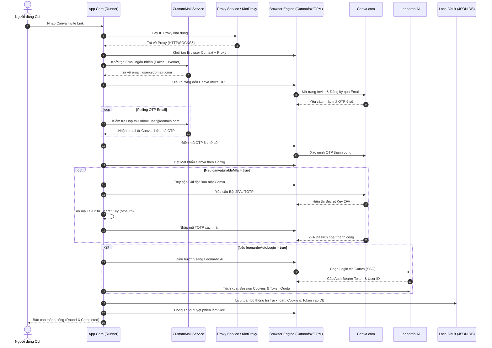

# 🚀 CanvaLeonardo CLI Tools

**CanvaLeonardo CLI Tools** là một bộ công cụ dòng lệnh (CLI Tool) doanh nghiệp được phát triển bằng **TypeScript** và **Node.js**, hỗ trợ tự động hóa toàn bộ quy trình từ đăng ký/đăng nhập tài khoản **Canva Pro** qua đường dẫn mời (Invite Link), thiết lập bảo mật 2 lớp (MFA/2FA), tự động đăng nhập **Leonardo.Ai** bằng Canva SSO, quản lý hệ thống trình duyệt Anti-detect (Camoufox, GPM-Login), xoay Proxy linh hoạt và quản lý/xuất cơ sở dữ liệu tài khoản tập trung (Local Vault).

---

## 📋 Mục lục

1. [Tính năng Nổi bật](#-tính-năng-nổi-bật)
2. [Kiến trúc Kỹ thuật & Công nghệ](#-kiến-trúc-kỹ-thuật--công-nghệ)
3. [Cấu trúc Dự án](#-cấu-trúc-dự-án)
4. [Yêu cầu Hệ thống & Cài đặt](#-yêu-cầu-hệ-thống--cài-đặt)
5. [Chi tiết Cấu hình (`config.json`)](#-chi-tiết-cấu-hình-configjson)
6. [Hướng dẫn Sử dụng Chi tiết](#-hướng-dẫn-sử-dụng-chi-tiết)
7. [Luồng Xử lý Hệ thống (Workflow)](#-luồng-xử-lý-hệ-thống-workflow)
8. [Cấu trúc Dữ liệu Vault & Xuất Data](#-cấu-trúc-dữ-liệu-vault--xuất-data)
9. [Xử lý Lỗi Thường gặp (Troubleshooting)](#-xử-lý-lỗi-thường-gặp-troubleshooting)
10. [Giấy phép (License)](#-giấy-phép-license)

---

## ✨ Tính năng Nổi bật

- **Tự động hóa Canva Pro Invite Signup**:
  - Nhận đường dẫn mời (Invite Link) Canva Pro và tự động tạo thông tin người dùng ngẫu nhiên qua `@faker-js/faker`.
  - Tích hợp dịch vụ **CustomMail Worker API** (`https://tempmail.benobaty.online`) cho phép chọn tên miền linh hoạt (`all-random`, `selected-random`).
  - Tự động bắt và giải mã OTP 6 chữ số gửi về hộp thư email.
  - Tự động thiết lập mật khẩu Canva chuẩn hóa theo cấu hình.
- **Tự động kích hoạt Canva MFA / 2FA**:
  - Tự động truy cập cài đặt bảo mật Canva, bật xác thực 2 yếu tố (TOTP/MFA).
  - Trích xuất khóa bí mật (MFA Secret Key) và tự động tính toán mã TOTP xác nhận thông qua thư viện `otpauth`.
- **Tự động hóa Leonardo.Ai & SSO Login**:
  - Đăng nhập tự động vào Leonardo.Ai bằng liên kết tài khoản Canva (Canva SSO) hoặc tài khoản trực tiếp.
  - Trích xuất Bearer Auth Token (JWT Token), Refresh Token, User ID và trạng thái Token Quota hàng ngày.
- **Hỗ trợ Đa Trình duyệt Anti-Detect**:
  - **Camoufox Engine**: Trình duyệt Firefox chống phát hiện cao cấp, tích hợp giả lập GeoIP, Humanize (mô phỏng thao tác chuột của con người), chặn WebRTC, tùy chỉnh WebGL và tối ưu tải ảnh.
  - **GPM-Login Integration**: Tương tác trực tiếp với GPM-Login REST API (`port 9495`) để quản lý phiên làm việc theo Group ID/Name.
  - **Chromium Native**: Tải và khởi tạo trình duyệt Chromium tiêu chuẩn của Playwright.
- **Quản lý Proxy Linh hoạt**:
  - **KiotProxy API**: Tự động xoay IP động qua API KiotProxy (`get-current-proxy`, `next-proxy`).
  - **File Proxy (.txt)**: Tự động nạp danh sách Proxy định dạng HTTP/SOCKS5 (`host:port` hoặc `host:port:user:pass`).
- **Xử lý Đa luồng & Đa vòng (Multi-threading & Multi-round)**:
  - Cho phép cấu hình số luồng chạy song song (`parallelThreads`) và số vòng lặp (`totalRounds`).
  - Đếm và báo cáo kết quả chi tiết từng vòng trên giao diện Terminal.
- **Local Vault & Xuất dữ liệu đa định dạng**:
  - Cơ sở dữ liệu cục bộ dạng JSON (`data/accounts_vault.json`) lưu trữ an toàn toàn bộ thông tin tài khoản.
  - Xuất dữ liệu linh hoạt ra **Excel (.xlsx)**, **JSON (.json)**, hoặc **TXT (.txt)** với tùy chọn dọn dẹp DB sau khi xuất.

---

## 🛠 Kiến trúc Kỹ thuật & Công nghệ

### Tech Stack

- **Ngôn ngữ**: TypeScript (Node.js ESM Modules, ESNext target).
- **Trình duyệt & Automation**: [Playwright](https://playwright.dev/), [Camoufox](https://camoufox.com/), GPM Browser REST API.
- **CLI & UX**: [@inquirer/prompts](https://www.npmjs.com/package/@inquirer/prompts), [Chalk](https://www.npmjs.com/package/chalk) (Terminal UI/Coloring).
- **Xử lý OTP & Cryptography**: `otpauth` (TOTP), `@faker-js/faker` (Mock Data Generator).
- **Xuất Dữ liệu**: `xlsx` (SheetJS Excel Generator).
- **Runtime Compiler**: `tsx` (TypeScript Execute without manual compile step).

---

## 📁 Cấu trúc Dự án

```
CanvaLeonardo/
├── config.json              # File cấu hình chính của ứng dụng
├── package.json             # Danh sách dependencies & npm scripts
├── tsconfig.json            # Cấu hình TypeScript compiler
├── data/
│   └── accounts_vault.json  # Cơ sở dữ liệu tài khoản cục bộ (Local Vault)
├── scripts/
│   └── enable-canva-mfa.ts  # Script hỗ trợ bật MFA Canva độc lập
└── src/
    ├── index.ts             # Entry point chính khởi chạy ứng dụng
    ├── cli/                 # Các màn hình CLI tương tác người dùng
    │   ├── settings.ts      # Menu cài đặt thông số hệ thống
    │   ├── export-data.ts   # CLI xuất dữ liệu vault ra Excel/JSON/TXT
    │   └── canva-invite-login.ts # Runner thực thi luồng invite + login
    ├── core/                # Các module xử lý logic cốt lõi
    │   ├── config.ts        # Interface, validate & loader cấu hình
    │   ├── canva-login.ts   # Logic đăng nhập & đăng ký Canva
    │   ├── canva-invite-login.ts # Xử lý nhận link invite Canva
    │   ├── canva-interactions.ts # Thao tác giao diện trên Canva
    │   ├── canva-mfa.ts     # Xử lý bật & nhập mã 2FA/MFA Canva
    │   ├── canva-password-reset.ts # Xử lý đặt lại mật khẩu Canva
    │   ├── canva-turnstile.ts# Xử lý Cloudflare Turnstile bot check
    │   ├── canva-page-stability.ts # Kiểm tra độ ổn định DOM Canva
    │   ├── leonardo.ts      # Logic tự động hóa Leonardo.Ai
    │   ├── cookie-export.ts # Trích xuất session & auth cookies
    │   ├── runtime-adapters.ts # Adapter giao tiếp trình duyệt
    │   └── workers.ts       # Quản lý luồng thực thi song song
    ├── services/            # Tích hợp dịch vụ bên ngoài & Vault
    │   ├── local-vault.ts   # Quản lý lưu trữ SQLite/JSON vault
    │   ├── custom-mail.ts   # Dịch vụ Mail Worker tùy chỉnh
    │   ├── canva-otp.ts     # Polling & bóc tách OTP từ Email
    │   ├── totp.ts          # Generator mã 2FA/TOTP
    │   ├── gpmlogin.ts      # API Wrapper giao tiếp GPM-Login
    │   └── kiotproxy.ts     # Client giao tiếp KiotProxy API
    ├── runtime/             # Runtime quản lý phiên làm việc trình duyệt
    │   └── browser-runtime.ts # Browser Runtime Context Wrapper
    └── utils/               # Tiện ích bổ trợ hệ thống
        ├── browser.ts       # Khởi tạo Playwright / Camoufox / GPM
        ├── proxy.ts         # Parser & Validator Proxy
        ├── logger.ts        # Custom Logger với format màu sắc
        ├── menu.ts          # Màn hình Menu chính (Inquirer)
        ├── screen.ts        # Tiện ích xóa màn hình console
        └── update.ts        # Kiểm tra cập nhật ứng dụng
```

---

## ⚙️ Yêu cầu Hệ thống & Cài đặt

### Yêu cầu Hệ thống

- **Node.js**: phiên bản `>= 20.0.0`
- **npm**: phiên bản `>= 10.0.0`
- **Hệ điều hành**: Windows 10/11, macOS, hoặc Linux.
- **(Tùy chọn)** [GPM-Login](https://gpmlogin.com/) nếu sử dụng Engine `gpm`.

### Các bước cài đặt

1. **Clone Repository**:
   ```bash
   git clone https://github.com/tmq9999/CanvaLeonardo-CLI-Tools.git
   cd CanvaLeonardo
   ```

2. **Cài đặt Dependencies**:
   ```bash
   npm install
   ```

3. **Cài đặt Browser Binaries (Playwright)**:
   ```bash
   npx playwright install firefox chromium
   ```

---

## ⚙️ Chi tiết Cấu hình (`config.json`)

Mọi thông số của ứng dụng được quản lý tại file `config.json` nằm ở thư mục gốc. Bạn có thể chỉnh sửa trực tiếp file này hoặc thông qua màn hình **Menu Cài đặt** của CLI.

### Mẫu `config.json` Chuẩn:

```json
{
  "general": {
    "parallelThreads": 2,
    "totalRounds": 2,
    "operationDelaySeconds": 2,
    "serviceMail": "custom",
    "browserVisible": true,
    "canvaPassword": "YourStrongPassword@123.",
    "canvaEnableMfa": false,
    "leonardoAutoLogin": true,
    "customMail": {
      "workerUrl": "https://tempmail.benobaty.online",
      "domains": [
        "benobaty.online",
        "chatgpt-support.com",
        "easygenstd.shop"
      ],
      "selectedDomains": [],
      "domainMode": "all-random"
    }
  },
  "proxy": {
    "mode": "none",
    "filePath": "proxies.txt"
  },
  "browser": {
    "engine": "gpm",
    "gpmPort": 9495,
    "gpmGroupId": "09ce8303-f32b-4efd-a428-2f71bf5a02c1",
    "gpmGroupName": "CanvaLeonardo",
    "camoufox": {
      "mode": "custom",
      "options": {
        "geoip": true,
        "humanize": true,
        "blockWebRTC": true,
        "blockWebGL": false,
        "blockImage": false
      }
    }
  }
}
```

### Bảng giải thích chi tiết các Tham số:

| Nhóm | Tham số | Kiểu dữ liệu | Mô tả & Giá trị chấp nhận |
| :--- | :--- | :--- | :--- |
| **general** | `parallelThreads` | `number` | Số luồng chạy đồng thời (từ `1` trở lên). |
| | `totalRounds` | `number` | Số vòng thực thi kế tiếp (từ `1` đến `100`). |
| | `operationDelaySeconds` | `number` | Thời gian nghỉ giữa các thao tác bấm/nhập trên giao diện (giây). |
| | `serviceMail` | `string` | Dịch vụ mail sử dụng: `"custom"` \| `"hotmail-outlook"` \| `"adguard-mail"`. |
| | `browserVisible` | `boolean` | `true` để mở cửa sổ trình duyệt (Headed), `false` để chạy ẩn (Headless). |
| | `canvaPassword` | `string` | Mật khẩu mặc định đặt cho các tài khoản Canva được tạo mới. |
| | `canvaEnableMfa` | `boolean` | `true` để tự động kích hoạt 2FA/MFA cho tài khoản Canva sau khi tạo. |
| | `leonardoAutoLogin` | `boolean` | `true` để tự động đăng nhập Leonardo.Ai qua Canva SSO sau khi đăng ký thành công. |
| **customMail** | `workerUrl` | `string` | Endpoint URL của API CustomMail Worker. |
| | `domains` | `string[]` | Danh sách tên miền email có sẵn thu thập từ Worker API. |
| | `selectedDomains` | `string[]` | Danh sách tên miền người dùng chọn riêng khi chạy ở chế độ `selected-random`. |
| | `domainMode` | `string` | Chế độ chọn tên miền email: `"all-random"` (ngẫu nhiên tất cả) hoặc `"selected-random"`. |
| **proxy** | `mode` | `string` | Chế độ Proxy: `"none"` (không dùng), `"kiot"` (dùng KiotProxy API), `"file"` (dùng file txt). |
| | `filePath` | `string` | Đường dẫn đến file chứa danh sách Proxy (định dạng `.txt`). |
| **browser** | `engine` | `string` | Engine trình duyệt: `"camoufox"` \| `"gpm"` \| `"chromium"`. |
| | `gpmPort` | `number` | Cổng HTTP REST API của GPM-Login (Mặc định: `9495`). |
| | `gpmGroupId` | `string` | ID nhóm profile trong GPM-Login. |
| | `gpmGroupName` | `string` | Tên nhóm profile trong GPM-Login. |
| **camoufox** | `geoip` | `boolean` | Ghi đè Timezone và Geolocation theo IP của Proxy. |
| | `humanize` | `boolean` | Mô phỏng đường đi con trỏ chuột tự nhiên như người dùng thật. |
| | `blockWebRTC` | `boolean` | Chặn rò rỉ IP thực qua WebRTC. |
| | `blockWebGL` | `boolean` | Chặn/Vô hiệu hóa WebGL fingerprinting. |
| | `blockImage` | `boolean` | Chặn tải hình ảnh để tối ưu tốc độ và dung lượng mạng. |

---

## 📖 Hướng dẫn Sử dụng Chi tiết

### Khởi chạy Giao diện Menu CLI chính

Để chạy ứng dụng ở chế độ tương tác Menu, thực thi lệnh:

```bash
npm run dev
```

Giao diện Main Menu hiện ra với 4 lựa chọn chính:

```text
? Main menu
❯ Bắt đầu
  Cài đặt
  Xuất Data
  Thoát
```

---

### 1. Luồng "Bắt đầu" (Start Invite Signup & Login)

1. Chọn **"Bắt đầu"** tại Menu chính.
2. Dán link mời Canva Pro (**Canva Invite URL**) khi hệ thống yêu cầu:
   ```text
   ? Nhập link invite canva: https://www.canva.com/brand/join?token=...
   ```
3. Hệ thống tự động tính toán tổng số lượng tài khoản cần xử lý (`tài khoản = totalRounds × parallelThreads`).
4. Các trình duyệt sẽ tự động mở ra, thực hiện đăng ký, nhận OTP, tạo mật khẩu, thiết lập 2FA (nếu bật), đăng nhập Leonardo.Ai và lưu toàn bộ kết quả vào Vault.

---

### 2. Luồng "Cài đặt" (Settings Menu)

Tại Menu **"Cài đặt"**, bạn có thể cấu hình chi tiết các tham số mà không cần sửa file JSON thủ công:

- **Số luồng & Số vòng**: Đặt số lượng browser chạy song song và số lượt lặp.
- **Chọn Browser Engine**: Chuyển đổi linh hoạt giữa Camoufox, GPM-Login hoặc Chromium.
- **Cấu hình Camoufox Anti-Detect**: Bật/tắt Humanize cursor, GeoIP, WebRTC blocking, Image blocking.
- **Cấu hình Proxy**: Nhập đường dẫn file TXT proxy hoặc chọn chế độ KiotProxy.
- **Cấu hình Domain Custom Mail**: Xem danh sách domain hiện có, chọn domain chỉ định.
- **Bật/tắt Canva MFA & Leonardo Auto Login**.

---

### 3. Luồng "Xuất Data" (Export Account Data)

Cho phép trích xuất cơ sở dữ liệu tài khoản từ `data/accounts_vault.json`:

1. Chọn **"Xuất Data"**.
2. Hệ thống hỏi xác nhận có xóa cơ sở dữ liệu sau khi xuất không:
   ```text
   ? Clear DB sau khi xuất? (y/N)
   ```
3. Chọn định dạng xuất mong muốn:
   - **Excel (.xlsx)**: Xuất file bảng tính với đầy đủ cột thông tin chi tiết.
   - **JSON (.json)**: Xuất file JSON nguyên bản dữ liệu vault.
   - **TXT (.txt)**: Xuất định dạng danh sách rút gọn `email|password|mfa_secret|leonardo_token`.
4. File kết quả được tạo tại thư mục root hoặc thư mục `data/`.

---

### Các lệnh NPM Script có sẵn

| Lệnh | Công dụng |
| :--- | :--- |
| `npm run dev` | Khởi chạy ứng dụng ở chế độ phát triển (Menu CLI tương tác). |
| `npm run canva:invite-login` | Khởi chạy trực tiếp luồng Canva Invite Runner mà không đi qua menu chính. |
| `npm run build` | Biên dịch toàn bộ mã nguồn TypeScript sang Javascript trong thư mục `dist/`. |
| `npm start` | Khởi chạy bản build đã biên dịch trong `dist/index.js`. |
| `npm test` | Chạy bộ kiểm thử tự động của ứng dụng bằng Node.js Test Runner. |

---

## 🔄 Luồng Xử lý Hệ thống (Workflow)

Dưới đây là sơ đồ trình tự (Sequence Diagram) mô tả toàn bộ luồng hoạt động tự động hóa của ứng dụng:



---

## 🗄 Cấu trúc Dữ liệu Vault & Xuất Data

Dữ liệu tài khoản được lưu trữ an toàn tại `data/accounts_vault.json` với cấu trúc JSON chuẩn hóa:

### Schema Dữ liệu Account Vault (`AccountRecord`):

```typescript
interface AccountRecord {
  id: string;                 // UUID duy nhất của phiên
  email: string;              // Email tài khoản (tạo từ CustomMail)
  canvaPassword?: string;     // Mật khẩu Canva
  canvaMfaSecret?: string;    // Mã Secret 2FA/TOTP Canva (nếu bật MFA)
  canvaCookies?: object[];    // Danh sách Cookies phiên làm việc Canva
  leonardoToken?: string;     // Auth Bearer Token đăng nhập Leonardo.Ai
  leonardoRefreshToken?: string; // Refresh Token Leonardo.Ai
  leonardoUserId?: string;    // User ID hệ thống Leonardo.Ai
  proxyUsed?: string;         // Proxy được sử dụng trong phiên
  createdAt: string;          // ISO Timestamp thời điểm khởi tạo
}
```

---

## 🛠 Xử lý Lỗi Thường gặp (Troubleshooting)

### 1. Không nhận được mã OTP từ Email

- **Nguyên nhân**: API Worker CustomMail quá tải hoặc domain mail bị dịch vụ chặn temporary.
- **Cách khắc phục**: Vào Menu **Cài đặt -> Domain Custom Mail**, chuyển `domainMode` sang `selected-random` và chọn các domain có độ ổn định cao.

### 2. GPM-Login báo lỗi "Connection Refused" (`port 9495`)

- **Nguyên nhân**: Phần mềm GPM-Login chưa được khởi chạy hoặc cổng API bị thay đổi.
- **Cách khắc phục**:
  1. Mở phần mềm GPM-Login trên máy tính.
  2. Vào phần Cài đặt của GPM-Login kiểm tra API Port (mặc định là `9495`).
  3. Đảm bảo nhóm Profile (`gpmGroupName` / `gpmGroupId`) đã được khởi tạo trong GPM-Login.

### 3. Gặp lỗi Cloudflare Turnstile / Bot Check

- **Nguyên nhân**: IP Proxy bị nghi ngờ hoặc fingerprint của trình duyệt bị phát hiện.
- **Cách khắc phục**:
  - Chuyển `engine` sang `camoufox`.
  - Bật tùy chọn `humanize: true` và `geoip: true` trong cài đặt Camoufox để mô phỏng hành vi con người và định vị theo IP.

---

## 📜 Giấy phép (License)

Dự án được phân phối dưới giấy phép **ISC License**. Chi tiết xem trong file `package.json`.

---

<p align="center">
  Developed with ❤️ for Automation Engineers & Content Creators.
</p>
